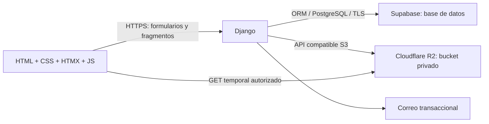

# ResiVe — Plan de producto y desarrollo

Fecha: 28 de octubre de 2026. Estado: propuesta lista para implementación, no aplicación implementada.

## 1. Objetivo y decisiones

Crear una plataforma inmobiliaria para Venezuela centrada en alquiler residencial, con una sección independiente de venta. Debe permitir descubrir viviendas, comparar condiciones, contactar al anunciante, coordinar visitas y administrar publicaciones desde el móvil.

Decisiones solicitadas: Python, HTML, CSS y JavaScript; interfaz sin recargas completas para las acciones habituales; PostgreSQL alojado en **Supabase**; archivos en un **bucket Cloudflare R2**.

Propuesta: monolito Django con plantillas y HTMX. Backend e interfaz viven en el mismo repositorio y despliegue, organizados en archivos separados. No incrustar HTML, CSS y JavaScript como cadenas dentro de Python. El navegador recibe HTML completo al entrar y fragmentos HTML al interactuar.

Supuestos de alcance: alquiler mensual de viviendas completas y habitaciones; compraventa residencial; contacto entre interesados y anunciantes. No será inicialmente un sistema de reservas turísticas ni de cobro de alquileres. El cierre de la operación ocurre entre las partes.

## 2. Personas, nombres y permisos

En la interfaz usar **«Busco vivienda»** y **«Publico inmuebles»**. «Anunciante» incluye propietarios y asesores inmobiliarios. Arrendador ofrece el alquiler; inquilino o arrendatario lo toma. No llamar arrendatario a quien publica una vivienda en alquiler.

| Persona | Capacidades |
|---|---|
| Visitante | Buscar, filtrar y ver anuncios publicados; consultar información pública |
| Usuario registrado | Favoritos, consultas, visitas, denuncias y gestión de su cuenta |
| Anunciante | Todo lo anterior más crear y administrar sus anuncios y atender interesados |
| Moderador | Revisar anuncios y denuncias, retirar contenido, registrar razones |
| Administrador | Gestionar permisos, catálogos, incidencias y configuración operativa |

Una cuenta puede buscar y publicar sin registrarse otra vez. «Propietario» y «asesor» son declaraciones del perfil, no pruebas de titularidad. Correo verificado, identidad verificada y propiedad comprobada son conceptos distintos; el MVP solo promete verificar correo.

Todo permiso se valida en Django en cada petición. Los identificadores impredecibles y los botones ocultos no sustituyen la autorización. Un moderador no obtiene acceso general a conversaciones privadas por su rol.

## 3. Alcance de lanzamiento y evolución

### Versión inicial completa

- Registro, verificación de correo, acceso, recuperación de contraseña y cierre de sesión.
- Perfil, preferencias de contacto y activación como anunciante.
- Catálogo geográfico nacional por entidad federal, ciudad/localidad y zona.
- Alquiler y venta con formularios, filtros y condiciones propios.
- Publicación por pasos, borradores, imágenes, moderación y estados de disponibilidad.
- Búsqueda, ordenación, paginación, detalle, favoritos y enlaces compartibles.
- Consultas privadas en forma de hilos y solicitudes de visita; sin chat en tiempo real.
- Notificaciones dentro de la web y correos transaccionales esenciales.
- Denuncias, bloqueo de contactos, moderación y registro de acciones.
- Panel del usuario, panel del anunciante y Django Admin para el equipo interno.
- Diseño adaptable, accesibilidad, SEO, manejo de errores y operación documentada.

### Después de validar uso real

1. Búsquedas guardadas y alertas, mapa, comparación de hasta tres viviendas, métricas de consultas útiles.
2. Organizaciones inmobiliarias con miembros y permisos; verificación documental con procedimiento definido.
3. Planes para anunciantes y destacados señalados como publicidad. Precios, facturación y proveedor de pago se decidirán antes de implementarlos.
4. Agenda avanzada, PWA instalable y notificaciones optativas; API móvil solo si hay una aplicación consumidora.
5. Contratos digitales, pagos, depósitos o gestión de arrendamientos como proyecto separado, con revisión operativa y jurídica.

No crear ahora reseñas de operaciones no comprobables, recomendaciones con IA, microservicios, motor de reservas, CRM completo ni aplicación móvil nativa.

## 4. Experiencia y pantallas

### Navegación pública

Inicio → Alquilar / Comprar → Resultados → Detalle → Consultar / Solicitar visita.

Inicio con alquiler seleccionado, estado y ciudad, presupuesto con moneda, tipos de vivienda y acceso claro a ventas. Mostrar datos reales o estados vacíos; nunca cifras, testimonios o anuncios supuestamente reales inventados.

Resultados: buscador, filtros activos, número de coincidencias, ordenación y tarjetas. En móvil, filtros en panel accesible; en escritorio, columna lateral. Tarjetas con foto, precio y periodicidad, zona, ciudad, tipo, habitaciones, baños y estacionamientos.

Detalle: galería, características, condiciones, disponibilidad declarada, gastos, servicios, ubicación aproximada, perfil público del anunciante, fecha de actualización, favorito, denuncia y contacto. La dirección exacta y las coordenadas precisas no se incluyen en HTML, JSON, metadatos ni imágenes públicas.

### Área privada

- Mi cuenta: perfil, correo, preferencias, contraseña y solicitud de eliminación.
- Mis favoritos: viviendas guardadas; indicar cuando dejan de estar disponibles.
- Consultas: hilos por inmueble con mensajes y estado leído.
- Visitas: solicitudes pendientes, propuestas alternativas, confirmadas y canceladas.
- Mis publicaciones: borradores, pendientes, publicadas, pausadas y cerradas.
- Editor: información → ubicación → precio/condiciones → fotos → revisión y envío.
- Moderación: cola de revisión, motivos, denuncias y auditoría en Django Admin.

### Estilo visual

Diseño propio de ResiVe: fondos claros, verde profundo como color principal y acento cálido para acciones secundarias; tipografía de sistema, imágenes amplias y jerarquía clara de precios. Validar contraste antes de fijar colores. Formularios con etiquetas, errores junto al campo y resumen enfocable; navegación con teclado, foco visible y reducción de movimiento.

El usuario debe distinguir un precio de venta de una mensualidad y saber si el anuncio es de propietario o asesor. No transmitir confianza mediante insignias ambiguas.

## 5. Datos del inmueble y reglas comerciales

Tipos iniciales: apartamento, casa, anexo, habitación y townhouse. Operación: alquiler o venta; una por anuncio. Un nuevo anuncio puede referenciar un inmueble existente, pero no se modelará un inventario inmobiliario separado hasta necesitarlo.

Campos comunes: título, descripción como texto plano, tipo, ubicación, superficie en m², dormitorios, baños, estacionamientos, amueblado, servicios, fotos y anunciante. Dormitorios admite cero para estudios; validar valores no negativos y límites razonables.

Alquiler: mensualidad, moneda, depósito declarado, anticipo declarado, estancia mínima, disponibilidad desde una fecha, servicios incluidos, mascotas y reglas de convivencia. Los costos adicionales se muestran por separado; no inventar condiciones legales por defecto.

Venta: precio total, moneda, negociable, características y situación documental declarada. No presentar esa declaración como verificación jurídica.

Servicios relevantes: agua, tanque, electricidad de respaldo, internet y tipo de conexión, gas, ascensor, accesibilidad y estacionamiento. Distinguir «sí», «no» y «sin informar» cuando corresponda; evitar interpretar vacío como ausencia.

Dinero con Decimal y moneda explícita, inicialmente USD y VES. Los filtros y la ordenación por precio requieren una moneda; con monedas mezcladas no se ordenan montos como si fueran equivalentes. Sin conversión automática en el MVP. Una conversión futura debe mostrar fuente, tasa y fecha y conservar siempre el precio original.

## 6. Geografía venezolana

Interfaz: **Estado → Ciudad/localidad → Zona/urbanización**. Internamente, «entidad federal» permite representar estados y otras divisiones sin convertir artificialmente cada territorio en un estado. No deducir ciudades a partir de municipios: son conceptos distintos.

Modelo inicial: FederalEntity, Locality y Zone. Cada localidad pertenece a una entidad y cada zona a una localidad; claves estables, nombres con tildes y alias para búsqueda. «Caracas» requiere contemplar localidades y sectores a ambos lados de límites administrativos; los alias metropolitanos no eliminan la entidad real de cada ubicación. Municipio y parroquia pueden añadirse como catálogos relacionados cuando exista una fuente validada.

Antes del lanzamiento se necesita un catálogo nacional con procedencia, fecha y licencia, revisado para duplicados, homónimos y relaciones. No afirmar cobertura completa basándose en una lista de capitales. Registrar cobertura por entidad y permitir solicitar una localidad faltante para moderación. Las fixtures de desarrollo serán identificables como muestra, nunca como catálogo oficial.

El importador será idempotente, tendrá simulación, validará referencias y no borrará ubicaciones usadas al actualizar. El frontend reinicia ciudad y zona al cambiar el padre y el backend rechaza combinaciones incompatibles.

## 7. Arquitectura y tecnologías

| Capa | Elección |
|---|---|
| Backend | Django 5.2 LTS con el parche vigente compatible; Python compatible y mantenido |
| Base de datos | PostgreSQL de Supabase; ORM y migraciones de Django, driver psycopg |
| Identidad | Django Auth, usuario personalizado desde la primera migración y sesiones |
| HTML | Django Templates, parciales y formularios Django |
| Interacciones remotas | HTMX, versión fijada y servida desde estáticos |
| Interacciones locales | JavaScript modular: galería, menú, vista previa y foco |
| Estilos | CSS propio con variables, Grid, Flexbox y componentes reutilizables |
| Archivos | R2 con django-storages y boto3; Pillow para validar y transformar fotos |
| Servidor | Despliegue Linux persistente con servidor WSGI y HTTPS |
| Correo | SMTP transaccional configurado por entorno; consola solo en desarrollo |
| Pruebas | Django TestCase con PostgreSQL desechable y Playwright para flujos críticos |

Confirmar compatibilidades y fijar versiones exactas al empezar; no instalar versiones futuras ni mezclar documentación de ramas distintas. La elección de 5.2 LTS prioriza estabilidad, no representa la última versión de Django. [Versiones oficiales](https://www.djangoproject.com/download/).



Estructura orientativa, crear módulos cuando su fase los necesite:

```text
config/                 settings, urls, wsgi
apps/accounts/          usuario, perfil, sesiones
apps/locations/         catálogo e importación
apps/listings/          anuncios, imágenes, búsqueda, favoritos
apps/inquiries/         consultas, mensajes, visitas, bloqueos
apps/moderation/        denuncias y acciones
apps/notifications/     avisos y entrega de correo
templates/              base, componentes, páginas y parciales
static/css/             tokens, base, componentes
static/js/              módulos pequeños
static/vendor/          HTMX fijado
tests/e2e/              recorridos de navegador
docs/                   decisiones, instalación y operación
```

## 8. Supabase: conexión y límites de confianza

Supabase se usa como PostgreSQL administrado. No se incorpora Supabase Auth, Storage ni Realtime al MVP: no son necesarios para esta arquitectura. Las sesiones Django y los usuarios se guardan en la misma base, sin duplicar cuentas en dos sistemas.

Para backend persistente: conexión directa si la red lo permite; pooler en modo sesión si el hosting solo tiene IPv4. Migraciones y backups usarán conexión directa desde un entorno compatible. No elegir modo transacción sin necesidad: requeriría revisar prepared statements, cursores y semántica de sesión. [Guía de conexión](https://supabase.com/docs/guides/database/connecting-to-postgres).

Decisiones de seguridad del proyecto:

- Proyecto dedicado por entorno; esquema privado `resive` para tablas de la aplicación y ruta de búsqueda controlada.
- Rol de migraciones con DDL; rol de ejecución con privilegios mínimos sobre tablas y secuencias. Probar permisos tras cada nueva migración.
- TLS con comprobación de certificado según configuración del proveedor; secretos solo en el servidor.
- No exponer `resive` mediante la Data API. Desactivar esa API si el proyecto dedicado no la usa y verificar también privilegios de los roles públicos.
- No asumir que RLS identifica automáticamente al usuario de una sesión Django. La autorización por usuario ocurre en Django; el rol PostgreSQL de la aplicación no representa a cada cliente.
- Ninguna clave de base de datos ni credencial `service_role` en el navegador. Este diseño no necesita un cliente Supabase JS.
- Limitar conexiones totales de workers, procesos y tareas al presupuesto real del proyecto.

Los esquemas expuestos, grants y RLS son controles diferentes; se debe verificar la configuración efectiva, no confiar en que ocultar el nombre de una tabla la protege. [Seguridad de la Data API](https://supabase.com/docs/guides/api/securing-your-api).

Desarrollo y CI usan PostgreSQL desechable o un proyecto Supabase de desarrollo. Nunca ejecutar el runner de pruebas, que puede crear o borrar bases, sobre producción. Las diferencias de red, permisos y almacenamiento requieren pruebas de integración específicas en staging.

## 9. R2: fotografías y acceso

Un bucket privado por entorno; acceso público y `r2.dev` desactivados. Los assets CSS/JS pertenecen al despliegue; los archivos subidos por usuarios van a R2. La integración usa el backend S3 de django-storages, endpoint de cuenta y credenciales limitadas al bucket. [Integración R2](https://django-storages.readthedocs.io/en/latest/backends/s3_compatible/cloudflare-r2.html).

Flujo inicial propuesto:

1. Usuario autenticado envía una foto a Django; el servidor verifica propiedad del anuncio y cuota.
2. Límite inicial: 15 fotos por anuncio, 8 MB por foto y 25 megapíxeles al decodificar. Validar en servidor y proxy, no solo en JavaScript.
3. Aceptar JPEG, PNG y WebP comprobando contenido; rechazar SVG y archivos que no se puedan decodificar. Corregir orientación, retirar EXIF/GPS y generar versiones optimizadas y miniaturas.
4. Subir a R2 con nombre aleatorio. Guardar en PostgreSQL claves de objeto, dimensiones, orden y metadatos, no binarios ni URLs firmadas permanentes.
5. Un endpoint de medios recibe el ID de foto, consulta permisos y estado del anuncio, y redirige a un GET firmado de cinco minutos. Fotos de anuncios publicados son visibles al público; borradores solo a dueño y moderación autorizada.
6. Aplicar `no-store` al endpoint de autorización y una política conservadora de caché para que no se almacenen redirecciones privadas compartidas. La firma concedida sigue válida hasta expirar: retirar una publicación bloquea nuevas firmas, pero no revoca copias descargadas.

Las URLs firmadas otorgan acceso temporal a quien las tenga y utilizan el endpoint S3; no asumir que sirven sobre un dominio personalizado. [Firmas de R2](https://developers.cloudflare.com/r2/api/s3/presigned-urls/). El bucket privado evita que un prefijo de «borradores» quede accesible por accidente; `r2.dev` está orientado a desarrollo, no a producción. [Acceso público de R2](https://developers.cloudflare.com/r2/buckets/public-buckets/).

No subir directamente desde el navegador inicialmente: el límite de 15 fotos permite validar y transformar en Django con una carga por archivo. Si el volumen lo exige, añadir cuarentena y carga directa firmada con validación posterior; CORS no es un control de autorización.

R2 y PostgreSQL no comparten transacción. Si falla el guardado, intentar eliminar el objeto recién creado; registrar fallos y reconciliar huérfanos con período de gracia. Eliminar objetos sustituidos solo después del commit. Limpieza idempotente, con modo simulación y nunca borrado masivo sin verificar referencias.

## 10. Modelo de datos mínimo

| Entidad | Contenido y relaciones |
|---|---|
| User | Usuario personalizado, correo único normalizado, verificación, estado y fechas |
| Profile | Nombre público, tipo declarado de anunciante, preferencias y teléfono privado |
| FederalEntity / Locality / Zone | Catálogo, claves de origen, alias y relaciones |
| Listing | Dueño, operación, tipo, ubicación, descripción, importes, moneda, disponibilidad y estado |
| ListingImage | Anuncio, claves R2, dimensiones, posición y texto alternativo |
| Amenity | Catálogo de servicios; relación con Listing |
| Favorite | Usuario + anuncio con restricción única |
| Inquiry / Message | Hilo anuncio-interesado-anunciante, participantes, mensajes y lectura |
| VisitRequest | Hilo, horario propuesto, zona horaria, estado y quién respondió |
| UserBlock | Bloqueador y bloqueado; impide nuevos contactos y mensajes |
| Report | Reportante, anuncio o mensaje reportado, categoría, descripción y resolución |
| ModerationAction | Actor, objeto, transición, motivo y fecha; edición restringida |
| Notification | Destinatario, evento y lectura |
| EmailDelivery | Destinatario, evento, intentos y estado para reintentos idempotentes |

Guardar timestamps en UTC y mostrar visitas con `America/Caracas`. Crear índices según consultas: estado de publicación, operación, entidad, localidad, moneda/precio y fecha; índices en participantes y destinatarios. No indexar todos los campos por defecto. Relaciones mediante claves foráneas, importes no negativos y unicidad para favoritos e hilos repetidos.

Privacidad: consultas, teléfonos y dirección exacta no forman parte del objeto público de un anuncio. Los mensajes son texto plano. No solicitar cédulas, documentos de propiedad o datos bancarios en el MVP.

## 11. Estados y flujos completos

Publicación: `borrador → pendiente → publicada`; rechazo vuelve a `requiere_cambios`; desde publicada se puede pausar, cerrar como alquilada/vendida o retirar por moderación. Reenviar cambios sustanciales lleva a pendiente y oculta temporalmente el anuncio: es más simple que mantener revisiones públicas paralelas. El editor debe explicar este efecto antes de guardar. Un anuncio alquilado no puede cerrarse como vendido, ni viceversa.

Solo moderación aprueba. No aceptar estado, dueño o verificación desde campos manipulables del formulario. No publicar sin ubicación válida, precio/moneda y al menos una foto procesada. Anuncios pendientes, retirados o cerrados desaparecen de resultados; las páginas públicas de retirados no revelan contenido anterior.

Contactos: correo verificado → crear consulta → notificar al anunciante → responder en hilo → proponer visita → aceptar, rechazar o proponer otro horario. Conservar los hilos de operaciones cerradas para sus participantes; impedir consultas nuevas. Bloqueos se aplican a las escrituras. WhatsApp es opcional por consentimiento del anunciante, sin enviar mensajes automáticos; un clic no equivale a una consulta confirmada ni a un alquiler.

Visitas: ninguna confirmación automática. Al reprogramar se solicita nueva aceptación; controlar actualizaciones concurrentes y evitar confirmaciones sobre una versión vieja. Una solicitud no reserva el inmueble ni genera obligación de pago.

Correo: evento persistido y entrega reintentable mediante comando programado. La consulta se considera guardada aunque falle SMTP; no duplicarla por reintentar la interfaz. No enviar conversaciones completas ni dirección exacta por correo.

## 12. Contrato de interfaz sin recargas

HTMX permite pedir fragmentos HTML y sustituir regiones de la página; el historial requiere una estrategia explícita. [Documentación oficial](https://htmx.org/docs/).

Decisiones para ResiVe:

| Acción | Comportamiento |
|---|---|
| Filtrar o paginar | GET, reemplazar resultados y contador, URL con querystring |
| Cambiar estado/ciudad | GET de opciones dependientes y limpieza de selecciones incompatibles |
| Guardar favorito | POST autenticado con CSRF, actualizar botón y anuncio accesible |
| Guardar borrador | POST, mostrar errores o confirmación sin perder entradas |
| Subir foto | POST multipart individual, progreso, vista previa y reintento |
| Responder consulta | POST, insertar mensaje confirmado por servidor |
| Navegar entre vistas | Mejora progresiva sobre enlaces reales; historial y títulos correctos |
| Abrir galería o filtros | JavaScript local; no consultar al servidor innecesariamente |

Cada URL navegable debe entregar documento completo al abrirla directamente. Diferenciar peticiones de fragmentos, navegación mejorada y restauración del historial; no devolver un fragmento huérfano al recargar. Si una ruta varía por cabeceras HTMX, declarar `Vary` adecuado y no compartir caché privada. Desactivar snapshots de historial en áreas con información privada.

Requisitos: CSRF en escrituras, GET sin cambios de negocio, debounce de búsqueda, cancelación de peticiones obsoletas, botones ocupados, protección de duplicados en servidor, mensajes de error y reintento, foco y región `aria-live`. Definir explícitamente cómo HTMX intercambia respuestas de validación 422 y maneja 403/429/500. El fallback de formularios normales debe seguir funcionando.

## 13. Rutas propuestas

| Método | Ruta | Uso |
|---|---|---|
| GET | `/`, `/alquileres/`, `/ventas/` | Inicio y resultados |
| GET | `/inmuebles/<uuid>/<slug>/` | Detalle; ID estable y slug canónico |
| GET | `/ubicaciones/ciudades/`, `/ubicaciones/zonas/` | Selectores dependientes |
| GET/POST | `/cuenta/registro/`, `/cuenta/acceso/`, `/cuenta/recuperar/` | Identidad |
| POST | `/cuenta/salir/` | Cierre de sesión con CSRF |
| GET/POST | `/panel/publicaciones/nueva/`, `/panel/publicaciones/<uuid>/editar/` | Editor |
| POST | `/panel/publicaciones/<uuid>/enviar/` | Solicitar revisión |
| POST | `/panel/publicaciones/<uuid>/estado/` | Transición permitida |
| POST | `/panel/publicaciones/<uuid>/fotos/` | Carga de foto |
| POST | `/panel/fotos/<uuid>/eliminar/` | Eliminación autorizada |
| GET | `/media/fotos/<uuid>/<variante>/` | Autorizar lectura y redirigir a R2 |
| POST | `/inmuebles/<uuid>/favorito/` | Establecer guardado sí/no, no toggle ambiguo |
| POST | `/inmuebles/<uuid>/consultar/` | Crear o recuperar hilo del interesado |
| GET/POST | `/panel/consultas/<uuid>/` | Ver y responder como participante |
| POST | `/panel/consultas/<uuid>/visitas/` | Proponer visita |
| POST | `/panel/visitas/<uuid>/responder/` | Aceptar, rechazar o reprogramar |
| POST | `/reportes/`, `/panel/bloqueos/` | Denunciar y bloquear |
| GET | `/panel/notificaciones/` | Avisos propios |
| POST | `/panel/notificaciones/<uuid>/leer/` | Marcar lectura |

No hace falta una API REST duplicada para servir esta interfaz. Los nombres pueden ajustarse coherentemente durante la implementación.

## 14. Calidad, seguridad y operación

- Autorización por objeto en anuncios, fotos, consultas, visitas y notificaciones; pruebas con dos usuarios distintos.
- Protección CSRF, escape de contenido, cookies seguras y límites de intentos en acceso, recuperación, contacto y cargas. Django no elimina la necesidad de diseñar estos controles. [Seguridad Django](https://docs.djangoproject.com/en/5.2/topics/security/).
- Secretos por entorno, logs sin contraseñas/tokens/teléfonos, páginas de error útiles y rastreo de incidencias.
- Caché pública solo donde no se mezcle estado de sesión; nunca paneles, mensajes o firmas privadas en caché compartida.
- Pruebas de formularios y permisos, integración PostgreSQL, fallos de R2/SMTP y recorridos Playwright.
- Verificar búsqueda, favorito, publicación y consulta sin navegación completa del documento; comprobar también enlaces directos, atrás/adelante y JavaScript desactivado.
- Imágenes responsive, lazy loading fuera de la portada, dimensiones reservadas y sin fuentes de terceros obligatorias. Objetivos de rendimiento, sujetos a medición: LCP ≤ 2,5 s, INP ≤ 200 ms y CLS ≤ 0,1 en páginas clave.
- SEO: títulos y descripciones únicos, canonical, sitemap solo de anuncios públicos, robots/noindex en áreas privadas y combinaciones de filtros sin valor. No tratar robots.txt como autorización. Imagen social de marca inicialmente para evitar depender de firmas expiradas.
- Backups de PostgreSQL y de objetos R2 por separado; simular restauración conjunta. Definir retención, RPO y RTO antes del lanzamiento; objetivos iniciales propuestos: RPO 24 horas y RTO 8 horas.
- Términos, privacidad, política de anuncios, tratamiento de denuncias y eliminación de cuenta. Son tareas de producto y revisión local, no textos legales validados por este documento.

Variables mínimas propuestas, sin valores secretos en Git: `DJANGO_SECRET_KEY`, `DJANGO_DEBUG`, `DJANGO_ALLOWED_HOSTS`, `CSRF_TRUSTED_ORIGINS`, `DATABASE_URL`, `MIGRATION_DATABASE_URL`, `R2_ACCOUNT_ID`, `R2_ACCESS_KEY_ID`, `R2_SECRET_ACCESS_KEY`, `R2_BUCKET_NAME`, `EMAIL_HOST`, `EMAIL_PORT`, `EMAIL_HOST_USER`, `EMAIL_HOST_PASSWORD`, `DEFAULT_FROM_EMAIL`, `PUBLIC_BASE_URL`.

Las opciones TLS deben quedar documentadas junto a las URLs de conexión. `.env.example` solo contiene placeholders; los secretos de producción se inyectan desde el hosting. El runtime no necesita recibir credenciales de migraciones.

## 15. Fases y criterios de salida

Estimación orientativa para una persona con experiencia y revisión de producto: 10–14 semanas; no es una cotización. La preparación geográfica, contenidos, proveedores y validaciones externas puede extender el calendario.

| Fase | Duración orientativa | Resultado verificable | Prompt |
|---|---|---|---|
| 0. Acuerdos | 2–3 días | Alcance, estados, navegación y backlog aceptables | 00–01 |
| 1. Base | 3–5 días | Django arranca, esquema/roles definidos, Supabase y R2 configurables | 02 |
| 2. Usuarios y ubicación | 1–2 semanas | Cuenta completa y catálogo importable validado | 03–04 |
| 3. Publicación | 2 semanas | Borrador, formulario y fotos privadas funcionales | 05–06 |
| 4. Descubrimiento | 1–2 semanas | Resultados, detalle y favoritos sin recargas | 07–08 |
| 5. Contacto | 1–2 semanas | Hilos, visitas, bloqueos y notificaciones | 09 |
| 6. Moderación | 1 semana | Revisión y denuncias con permisos y auditoría | 10 |
| 7. Preparación de lanzamiento | 2 semanas | Accesibilidad, seguridad, restauración y staging probados | 11–13 |

Cada fase integra backend y frontend. Una tabla creada sin formulario funcional o una pantalla alimentada solo con mocks no completan una función.

## 16. Puerta de lanzamiento

Una cuenta puede registrarse, verificar correo, publicar, cargar fotos en R2 y enviar a revisión. Un moderador aprueba. Otra cuenta encuentra el inmueble por entidad y ciudad, guarda favorito, consulta y solicita visita. El anunciante responde y cierra el anuncio. Una tercera cuenta no puede leer el hilo ni editar el inmueble. Retirar el anuncio corta nuevas lecturas autorizadas de sus fotos.

Además: catálogo nacional con cobertura revisada; restauración de base y archivos comprobada; configuración real de Supabase/R2 validada; correos entregables; política de soporte y moderación disponible; ningún fallo crítico de permisos, privacidad o pérdida de datos abierto.

## 17. Estado actual y pendientes externos

La revisión inicial encontró únicamente README.md como archivo de proyecto fuera de Git. No hay proyecto ResiVe indexado en codebase-memory; se verificó el listado local como fallback. No se modificó el README existente.

Estos documentos no crean recursos cloud ni verifican credenciales. Al implementar se necesitarán proyectos Supabase, buckets R2, hosting Python, dominio, correo transaccional y fuente geográfica con licencia. Se puede avanzar con configuración, pruebas locales y placeholders sin inventar conexiones exitosas.

No se verificaron normas inmobiliarias venezolanas ni se seleccionó todavía el catálogo territorial. Evitar convertir campos sugeridos de alquiler en requisitos legales o afirmar cobertura nacional completa hasta validar esos puntos.
